# Шаг 2. Проектирование веб-приложения Test Manager

## 2.1. Исходное состояние и цель проектирования

Test Manager — веб-приложение для онлайн-тестирования студентов. Преподаватели создают и публикуют тесты, управляют вопросами и анализируют результаты. Студенты проходят доступные тесты, получают результаты и просматривают историю прохождений.

Исходный проект реализован как монолитное backend-приложение на Node.js и Express.js с общей базой MySQL. Клиентская часть использует React и Vite. Для аутентификации применяются JWT, для хэширования паролей — `bcrypt`.

Цель этапа — спроектировать **целевую микросервисную архитектуру**, сохранив функции исходного приложения. Микросервисы, API Gateway, RabbitMQ, отдельные базы и observability ниже являются проектируемыми компонентами, а не утверждением, что они уже реализованы.

### 2.1.1. Основные функции

- регистрация, авторизация и завершение сессии;
- роли `student` и `teacher`;
- создание, редактирование и публикация тестов;
- управление вопросами и вариантами ответов;
- прохождение теста с ограничением времени;
- сохранение закрытых и текстовых ответов;
- автоматическая проверка ответов и расчёт результатов;
- просмотр истории и статистики студентом;
- просмотр преподавателем результатов по его тестам.

### 2.1.2. Бизнес-правила

1. Email уникален, перед сохранением удаляются пробелы по краям и адрес приводится к нижнему регистру.
2. Пароль должен содержать не менее 8 символов и хранится только в виде хэша.
3. Поддерживаются роли `student` и `teacher`.
4. Тест должен содержать от 5 до 20 вопросов.
5. Закрытый вопрос должен содержать минимум два варианта ответа.
6. У каждого вопроса должен быть хотя бы один правильный ответ; у типа `single` — ровно один.
7. Типы вопросов: `single`, `multiple`, `text`.
8. Время теста — от 5 до 30 минут.
9. Один студент может пройти конкретный тест только один раз.
10. После публикации запрещено изменять структуру теста и правильные ответы. Разрешённые изменения метаданных определяются политикой приложения.
11. Студент может проходить только опубликованные и доступные ему тесты.
12. Студент видит собственные результаты; преподаватель — результаты по тестам, которыми он владеет.
13. Правильные ответы не раскрываются до завершения попытки.
14. После завершения или истечения времени ответы изменять нельзя.
15. Повторная отправка запроса и повторная доставка события не должны создавать дубликаты попыток, результатов или уведомлений.

### 2.1.3. Целевая архитектура

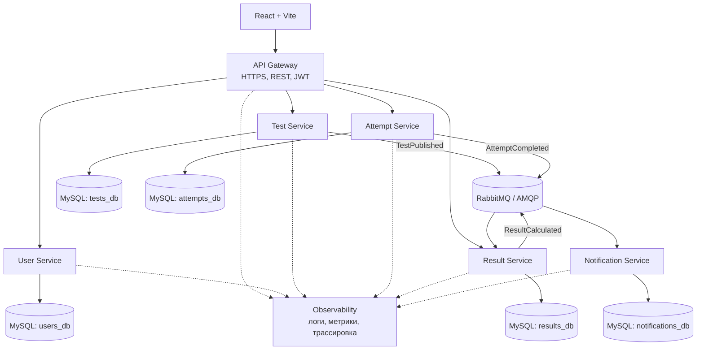

Показанные базы — логическое распределение данных в целевом состоянии. На этапе миграции исходная MySQL-база может временно оставаться общей.

## 2.2. Количество и назначение микросервисов

Предлагается пять бизнес-микросервисов. API Gateway и RabbitMQ — инфраструктурные компоненты.

| Микросервис | Ответственность | Данные |
|---|---|---|
| User Service | Регистрация, вход, выход, профиль, роли, JWT | Пользователи |
| Test Service | Тесты, вопросы, варианты ответов, проверка публикации | Тесты, вопросы, ответы |
| Attempt Service | Начало и завершение попыток, таймер, сохранение ответов | Попытки и ответы студентов |
| Result Service | Проверка ответов, баллы, результаты, история и аналитика | Итоговые результаты |
| Notification Service | Обработка событий, уведомления о публикации и готовности результата | Уведомления |

### 2.2.1. User Service

Управляет учётными записями и аутентификацией. Получает HTTP-запросы от Gateway, хранит пользователей в `users_db`, хэширует пароли с `bcrypt`, выпускает JWT и увеличивает `token_version` при выходе. Для корректной инвалидации middleware должен сверять версию из токена с актуальной версией пользователя.

Основные классы: `User`, `AuthController`, `AuthService`, `TokenService`, `UserRepository`.

### 2.2.2. Test Service

Управляет тестами, вопросами, вариантами ответов и публикацией. Хранит данные в `tests_db`, проверяет количество вопросов, варианты и правильные ответы, блокирует изменение структуры после публикации. Предоставляет Attempt Service внутренний API для чтения опубликованного теста без раскрытия ключа ответов клиенту и публикует `TestPublished`.

Основные классы: `Test`, `Question`, `Answer`, `TestController`, `TestService`, `PublicationValidator`, `TestRepository`, `EventPublisher`.

### 2.2.3. Attempt Service

Создаёт попытки, проверяет доступность теста, контролирует время, сохраняет ответы и фиксирует завершение. Использует `attempts_db`, обращается к Test Service за опубликованным тестом и публикует `AttemptCompleted`. Итоговую оценку не рассчитывает.

Основные классы: `Attempt`, `UserAnswer`, `AttemptController`, `AttemptService`, `TimerService`, `AttemptRepository`, `EventPublisher`.

### 2.2.4. Result Service

Получает `AttemptCompleted`, запрашивает данные попытки у Attempt Service и ключ правильных ответов у Test Service, рассчитывает `score` и `max_score`, сохраняет результат в `results_db` и публикует `ResultCalculated`. Предоставляет API для истории и аналитики, проверяя права доступа.

Основные классы: `Result`, `ResultEventConsumer`, `GradingService`, `ResultQueryService`, `ResultRepository`, `ResultEventPublisher`.

### 2.2.5. Notification Service

Обрабатывает `TestPublished` и `ResultCalculated`. Хранит уведомления в `notifications_db` и при необходимости отправляет их через внешний почтовый провайдер по HTTPS. Внешний провайдер является необязательным.

Основные классы: `Notification`, `NotificationEventConsumer`, `NotificationService`, `NotificationRepository`, `NotificationSender`.

### 2.2.6. Инфраструктурные компоненты

- **API Gateway** — единая внешняя точка входа, маршрутизация, общие ограничения запросов. Проверка прав должна выполняться и внутри сервиса.
- **RabbitMQ** — асинхронная передача событий, буферизация сообщений при временной недоступности потребителя.
- **MySQL** — реляционное хранение. Сервис получает права записи только на собственную базу/схему.

## 2.3. Диаграмма компонентов

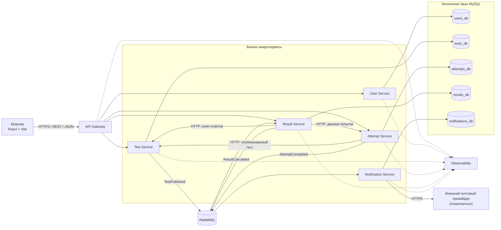

### 2.3.1. Потоки взаимодействия

1. Пользователь регистрируется или входит через Gateway; User Service создаёт пользователя или выдаёт JWT.
2. Преподаватель создаёт тест и добавляет вопросы. Test Service проверяет правила и публикует тест.
3. После публикации Test Service отправляет `TestPublished`.
4. Студент начинает попытку. Attempt Service проверяет пользователя, публикацию теста и лимит попыток.
5. Ответы сохраняются Attempt Service; после завершения фиксируется `finished_at`.
6. Attempt Service публикует `AttemptCompleted`.
7. Result Service получает ответы и ключ правильных ответов, рассчитывает и сохраняет результат.
8. Result Service публикует `ResultCalculated`, а Notification Service обрабатывает событие.
9. Студент запрашивает результат через Gateway. Пока расчёт не завершён, API может возвращать `202 Accepted`.

### 2.3.2. Надёжность

Рекомендуется паттерн **Transactional Outbox**: сервис в одной транзакции с бизнес-изменением записывает событие в таблицу Outbox, а отдельный publisher передаёт его в RabbitMQ. Потребители должны быть идемпотентными; настраиваются подтверждения обработки, ограниченные повторные попытки и dead-letter queue. Для связи обработки события с запросом в трассировке передаётся `trace_id`.

## 2.4. Распределение данных и взаимодействие сервисов

| Исходная таблица | Целевой владелец | Целевая база |
|---|---|---|
| `users` | User Service | `users_db` |
| `tests`, `questions`, `answers` | Test Service | `tests_db` |
| `attempts`, `user_answers` | Attempt Service | `attempts_db` |
| `results` | Result Service | `results_db` |
| `notifications` (новая) | Notification Service | `notifications_db` |
| `outbox_events` (новая, рекомендуется) | Сервис-публикатор | База соответствующего сервиса |

В текущем монолите таблицы связаны внешними ключами. В целевой микросервисной архитектуре каждый сервис записывает только собственные данные. Межсервисные ссылки (`author_id`, `user_id`, `test_id`) остаются идентификаторами без SQL-внешних ключей между базами. Проверка доступа и получение данных выполняются через внутренние API и события.

### 2.4.1. План миграции

1. Зафиксировать текущую схему БД и маршруты API.
2. Определить контракты сервисов и владение данными.
3. Выделить User Service.
4. Выделить Test Service.
5. Выделить Attempt Service.
6. Выделить Result Service.
7. Подключить RabbitMQ, Outbox и Notification Service.
8. Настроить Gateway, observability и OpenAPI.
9. Провести интеграционные и регрессионные проверки.

Миграция выполняется поэтапно. В переходный период сервисы могут временно работать с одним сервером MySQL, но доступ к таблицам должен быть ограничен по владельцу.

## 2.5. Диаграмма базы данных

### 2.5.1. Выбранная СУБД

Используется реляционная СУБД **MySQL**. Исходная схема содержит семь таблиц: `users`, `tests`, `questions`, `answers`, `attempts`, `user_answers` и `results`. Диаграммы ниже показывают целевое распределение таблиц по сервисам; поля исходных таблиц сохранены. `PK` — первичный ключ, `FK` — внешний ключ, `UK` — уникальное ограничение.

### 2.5.2. User Service — `users_db`

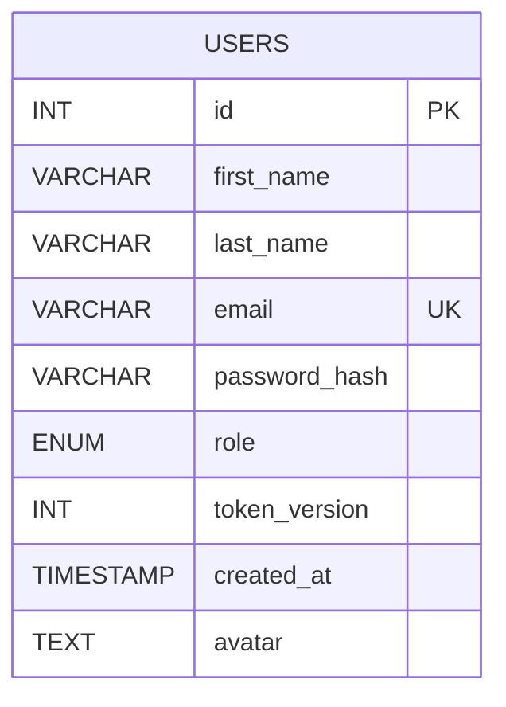

`users` хранит имя, фамилию, email, хэш пароля, роль, версию токена, дату создания и аватар. `email` уникален. `password_hash` никогда не возвращается публичным API.

### 2.5.3. Test Service — `tests_db`

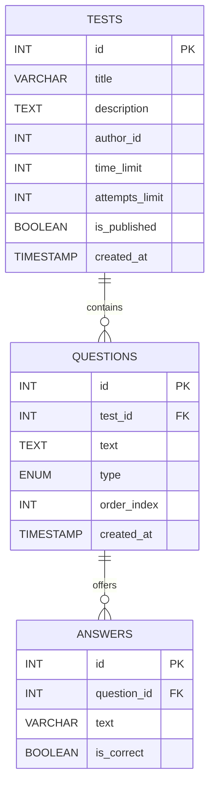

`author_id` — идентификатор User Service без межсервисного внешнего ключа. `questions.test_id` ссылается на `tests.id`, `answers.question_id` — на `questions.id`. `time_limit` задаёт время в минутах, `attempts_limit` — число разрешённых попыток, `is_published` — состояние публикации. `type` принимает `single`, `multiple` или `text`. Уникальные ограничения порядка вопросов и текста варианта сохраняются внутри базы Test Service.

### 2.5.4. Attempt Service — `attempts_db`

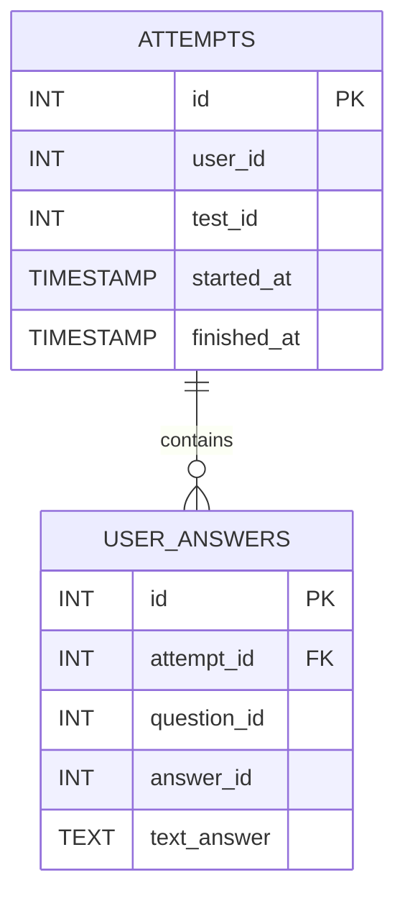

`user_id` и `test_id` — идентификаторы других сервисов без межсервисных FK. `user_answers.attempt_id` — FK на `attempts.id`. `question_id` и `answer_id` идентифицируют сущности Test Service. `answer_id` допускает `NULL` для текстового ответа. В исходной таблице `attempts` нет поля `status`; состояние может определяться по `finished_at` или быть добавлено отдельной миграцией.

Для строгой одной попытки на пользователя и тест требуется защита от параллельного создания попыток. Уникальность `(user_id, test_id)` подходит только если лимит всегда равен единице; для произвольного лимита нужен транзакционный контроль.

### 2.5.5. Result Service — `results_db`

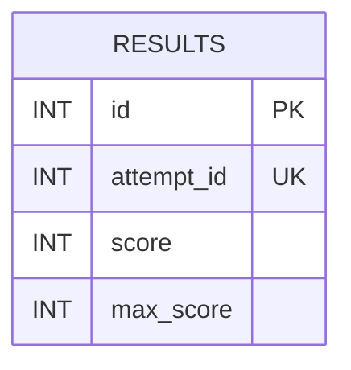

`results` хранит набранные (`score`) и максимально возможные (`max_score`) баллы. `attempt_id` уникален. В исходной схеме нет полей `percentage`, `status` или `calculated_at`; процент вычисляется на уровне сервиса, если `max_score > 0`.

### 2.5.6. Notification Service — `notifications_db`

Таблица уведомлений отсутствует в исходной БД и предлагается для целевой архитектуры.

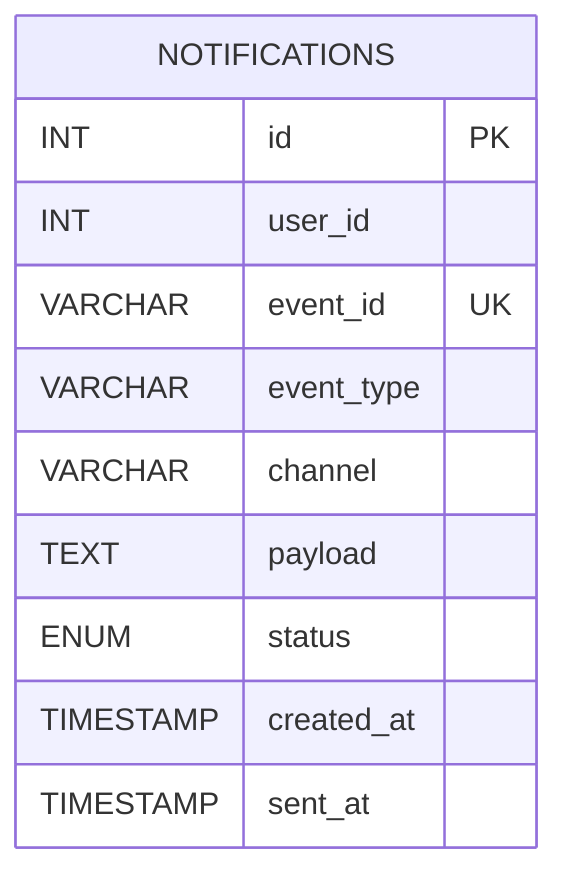

`user_id` ссылается на пользователя по идентификатору без межсервисного FK. `event_id` уникален для защиты от дублей. `status` может принимать `pending`, `sent`, `failed`.

### 2.5.7. Outbox

Для надёжной публикации событий рекомендуется дополнительная таблица в базе каждого сервиса-публикатора:

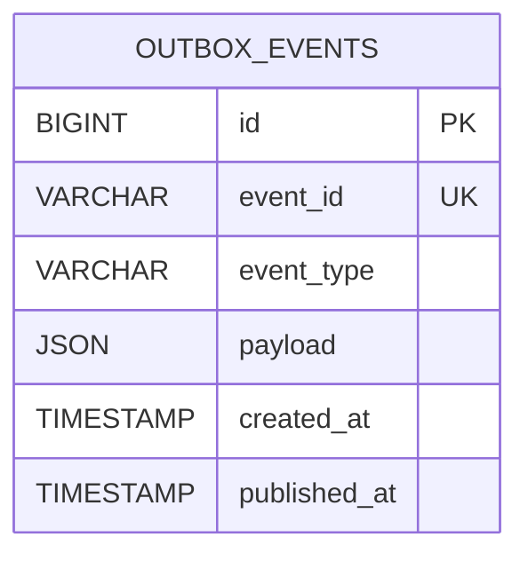

Событие записывается в Outbox в той же транзакции, что и бизнес-изменение, после чего фоновый publisher передаёт его в RabbitMQ. Это дополнительное проектное решение, не входящее в исходную схему.

### 2.5.8. Связи и ограничения

В исходной БД все семь таблиц связаны внешними ключами. В целевой архитектуре FK сохраняются внутри одного сервиса, например `questions.test_id` и `answers.question_id` в Test Service, `user_answers.attempt_id` в Attempt Service. Межсервисные ссылки остаются идентификаторами. Правила публикации, количество вопросов, корректность ответов, лимит времени и попыток проверяются сервисами, так как текущих ограничений БД недостаточно для всех этих правил.

## 2.6. Диаграммы классов

Диаграммы описывают проектируемую структуру микросервисов, а не утверждают, что классы уже существуют в монолите.

### 2.6.1. User Service

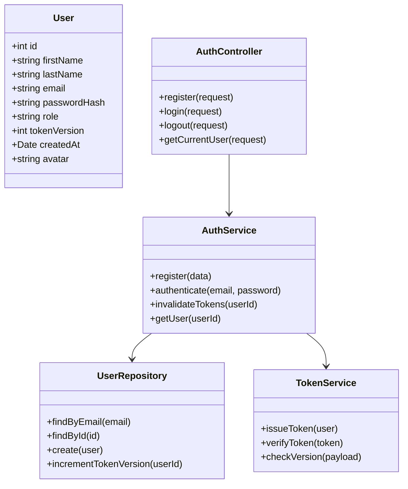

### 2.6.2. Test Service

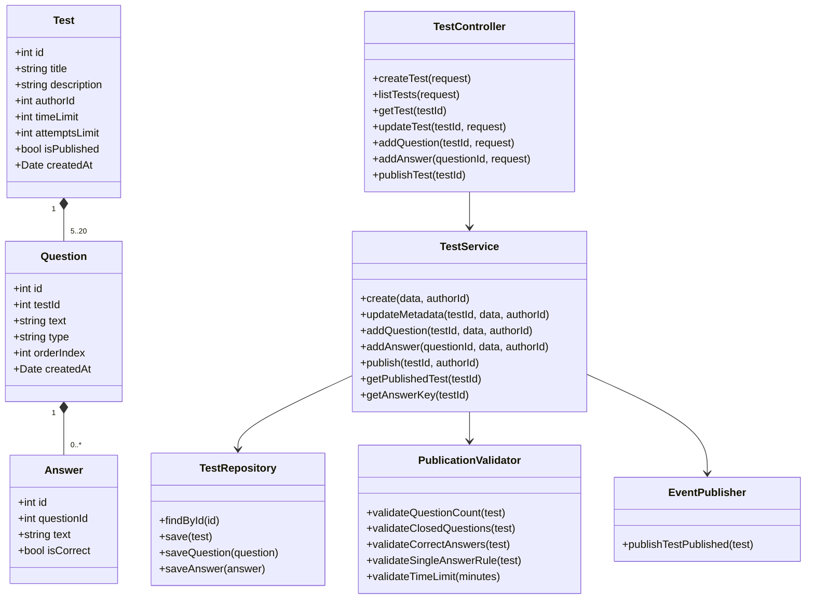

В исходной таблице `questions` нет поля `points`, поэтому оно не включено в класс `Question`.

### 2.6.3. Attempt Service

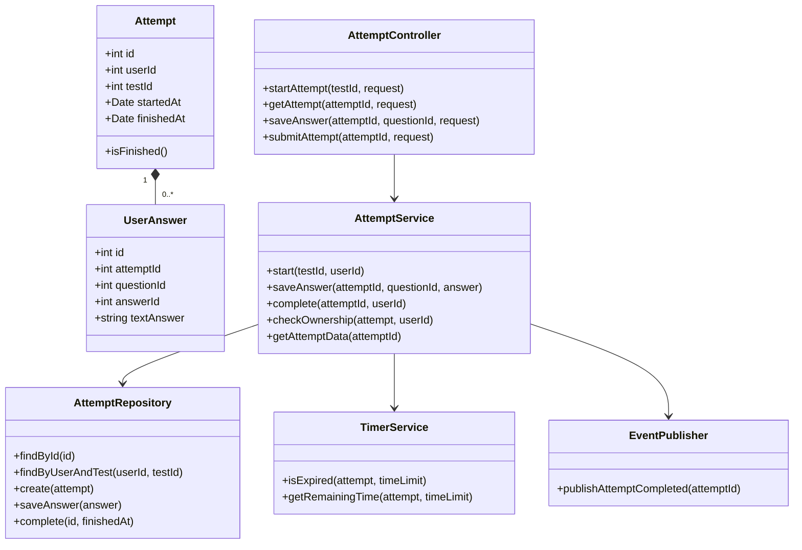

В исходной таблице `attempts` нет поля `status`. Метод `isFinished()` является вычисляемым, например по наличию `finishedAt`.

### 2.6.4. Result Service

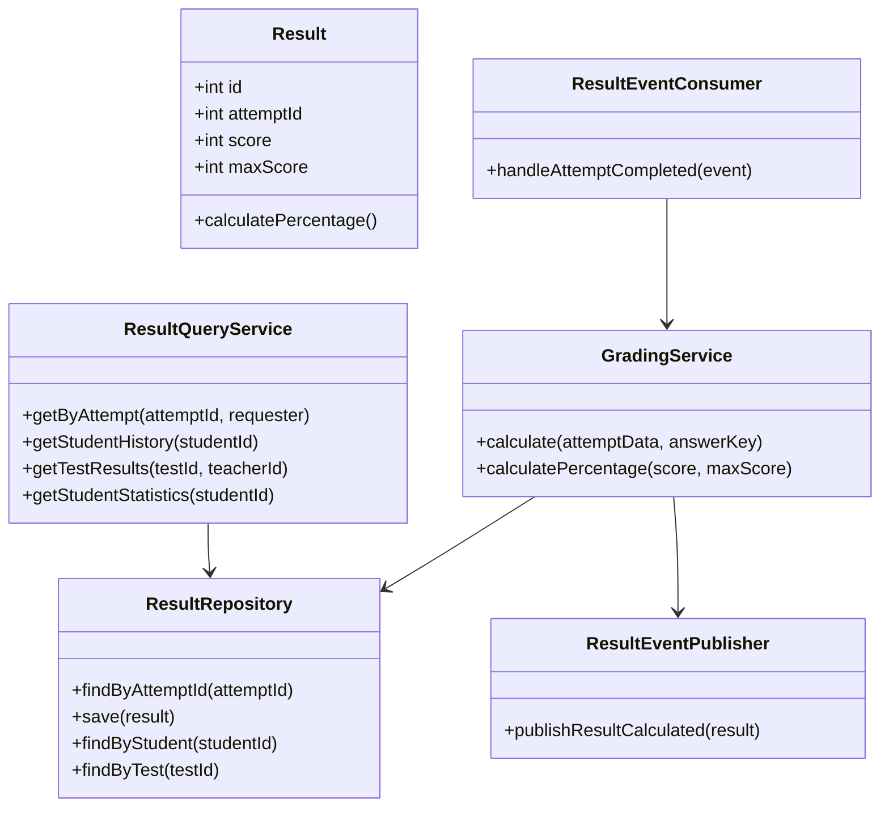

`Result` содержит поля исходной таблицы `results`. Процент и статистика вычисляются сервисом и не считаются колонками исходной БД.

### 2.6.5. Notification Service

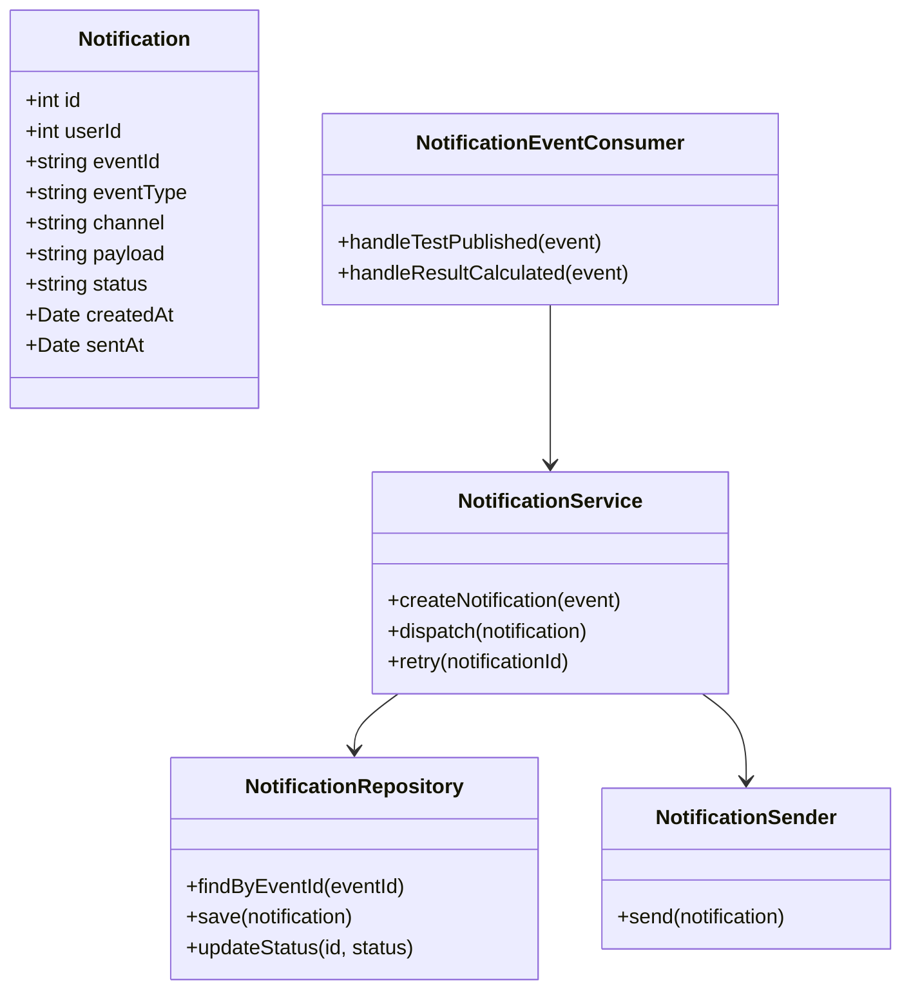

Notification Service и его таблица являются частью целевой архитектуры и требуют реализации.

## 2.7. Проектирование API-контрактов

### 2.7.1. Общие положения

Внешний API публикуется через Gateway по HTTPS, стиль — REST, формат — JSON UTF-8. Базовый адрес целевой системы: `https://<домен-приложения>/api`. Защищённые методы используют `Authorization: Bearer <JWT>`. Время передаётся в ISO 8601.

Единый формат ошибки:

```json
{
  "error": {
    "code": "VALIDATION_ERROR",
    "message": "Описание ошибки",
    "details": []
  }
}
```

Коды ответов: `200` — успешно; `201` — ресурс создан; `202` — асинхронная обработка; `400` — неверные данные; `401` — не пройдена аутентификация; `403` — недостаточно прав; `404` — ресурс не найден; `409` — конфликт состояния; `429` — превышен лимит запросов; `500` — внутренняя ошибка; `503` — сервис или зависимость временно недоступны.

Ниже описан **целевой контракт**. Пути, которые отличаются от текущих маршрутов Express, нужно согласовать при реализации Gateway и OpenAPI.

### 2.7.2. User Service

#### `POST /api/auth/register`

**Назначение:** зарегистрировать пользователя.

Тело запроса:

```json
{
  "first_name": "Иван",
  "last_name": "Иванов",
  "email": "ivan@example.com",
  "password": "StrongPassword123",
  "role": "student"
}
```

Поля обязательны; имя и фамилия не должны быть пустыми после `trim`; email должен иметь корректный формат и нормализуется к нижнему регистру; пароль не короче 8 символов; роль — `student` или `teacher`. В production создание роли teacher рекомендуется ограничить приглашением или администратором.

Ответы:
- `201`: `{ "message": "User created" }`
- `400`: обязательные поля отсутствуют, email некорректен, пароль слишком короткий или роль недопустима.
- `409`: email уже существует.
- `500`: ошибка БД или сервера.

Существующий обработчик использует `bcrypt.hash(password, 10)` и возвращает `{ "message": "User created" }`. Уникальность email обеспечивается ограничением БД.

#### `POST /api/auth/login`

**Назначение:** проверить учётные данные и выдать JWT.

Тело:

```json
{
  "email": "ivan@example.com",
  "password": "StrongPassword123"
}
```

Ответы:
- `200`: `{ "token": "<JWT>" }`
- `401`: пользователь не найден или пароль неверен.
- `500`: ошибка БД или сервера.

JWT может содержать `id`, `role`, `version`, `first_name`, `last_name`, `avatar`, `email`. Срок действия задаётся конфигурацией. Секрет JWT должен храниться в переменных окружения или секрет-хранилище, а не в исходном коде.

#### `POST /api/auth/logout`

**Назначение:** завершить сессию.

Заголовок: `Authorization: Bearer <JWT>`. Тело не требуется.

Ответы:
- `200`: `{ "message": "Logged out" }`
- `401`: токен отсутствует или недействителен.
- `500`: не удалось увеличить `token_version`.

Чтобы увеличение `token_version` действительно аннулировало старые токены, middleware должно сверять версию в JWT с актуальным значением User Service.

#### `GET /api/auth/me`

**Назначение:** получить профиль текущего пользователя.

Ответы:
- `200`: `{ "id": 12, "first_name": "Иван", "last_name": "Иванов", "email": "ivan@example.com", "role": "student", "avatar": null }`
- `401`: токен отсутствует или недействителен.
- `500`: ошибка сервера.

### 2.7.3. Test Service

Пути в данном подразделе — проектируемый внешний API; перед сдачей необходимо сопоставить их с фактическими файлами маршрутов Express.

#### `GET /api/tests`

**Назначение:** получить список тестов, доступных текущему пользователю.

Query-параметры: `status` (`draft` или `published`, если разрешено роли), `page` (по умолчанию 1), `limit` (по умолчанию 20, максимум 100).

Ответы:
- `200`: `{ "items": [{ "id": 10, "title": "Первый", "description": "Первый", "time_limit": 5, "attempts_limit": 1, "is_published": true }], "page": 1, "limit": 20, "total": 1 }`
- `400`: неверные параметры.
- `401`: нет действительного JWT.
- `403`: запрос недоступных черновиков или данных.
- `500`: ошибка сервера.

Студент видит опубликованные тесты, преподаватель — собственные тесты.

#### `POST /api/tests`

**Назначение:** создать черновик теста.

Тело:

```json
{
  "title": "Основы SQL",
  "description": "Проверка базовых знаний SQL",
  "time_limit": 15,
  "attempts_limit": 1
}
```

`title` обязателен; `description` необязателен; `time_limit` — целое от 5 до 30; `attempts_limit` — положительное целое, по текущим правилам равное 1. Автор определяется по JWT.

Ответы:
- `201`: `{ "id": 11, "title": "Основы SQL", "time_limit": 15, "attempts_limit": 1, "is_published": false }`
- `400`: невалидные поля.
- `401`: нет действительного JWT.
- `403`: пользователь не преподаватель.
- `500`: ошибка сервера.

#### `GET /api/tests/{testId}`

**Назначение:** получить сведения о тесте. Студенту доступны только опубликованные тесты; преподавателю — собственные.

Ответы:
- `200`: `{ "id": 10, "title": "Первый", "description": "Первый", "time_limit": 5, "attempts_limit": 1, "is_published": true }`
- `401`: нет действительного JWT.
- `403`: нет прав на просмотр.
- `404`: тест не найден.
- `500`: ошибка сервера.

#### `PATCH /api/tests/{testId}`

**Назначение:** изменить разрешённые метаданные теста.

Тело может содержать `title`, `description`, `time_limit`. Изменение структуры вопросов и правильных ответов после публикации запрещено.

Ответы:
- `200`: обновлённый объект теста.
- `400`: пустое тело или невалидные значения.
- `401`: нет действительного JWT.
- `403`: нет прав владельца/преподавателя.
- `404`: тест не найден.
- `500`: ошибка сервера.

#### `POST /api/tests/{testId}/questions`

**Назначение:** добавить вопрос в черновик.

Тело:

```json
{
  "text": "Что делает оператор SELECT?",
  "type": "single",
  "order_index": 1
}
```

`text` обязателен; `type` — `single`, `multiple` или `text`; `order_index` — положительное целое и уникален в рамках теста. В текущей таблице `questions` нет поля `points`.

Ответы:
- `201`: `{ "id": 21, "test_id": 10, "text": "Что делает оператор SELECT?", "type": "single", "order_index": 1 }`
- `400`: невалидные данные.
- `401`: нет действительного JWT.
- `403`: нет прав на редактирование.
- `404`: тест не найден.
- `409`: тест опубликован или порядковый номер уже занят.
- `500`: ошибка сервера.

#### `POST /api/questions/{questionId}/answers`

**Назначение:** добавить вариант ответа к закрытому вопросу.

Тело:

```json
{
  "text": "Выбор данных из таблицы",
  "is_correct": true
}
```

Ответы:
- `201`: `{ "id": 72, "question_id": 21, "text": "Выбор данных из таблицы", "is_correct": true }`
- `400`: невалидные данные или вопрос типа `text`.
- `401`: нет действительного JWT.
- `403`: нет прав на редактирование.
- `404`: вопрос не найден.
- `409`: тест опубликован или текст варианта дублируется.
- `500`: ошибка сервера.

#### `PATCH /api/tests/{testId}/publish`

**Назначение:** проверить и опубликовать тест.

Тело не требуется. Проверяются 5–20 вопросов, минимум два варианта для закрытых вопросов, наличие правильного ответа у каждого вопроса, ровно один правильный вариант для `single`, допустимое время и корректность типов.

Ответы:
- `200`: `{ "id": 10, "is_published": true }`
- `400`: тест не прошёл проверку.
- `401`: нет действительного JWT.
- `403`: пользователь не владелец или не преподаватель.
- `404`: тест не найден.
- `409`: тест уже опубликован или состояние не допускает публикацию.
- `500`: ошибка сервера.

После фиксации публикации Test Service отправляет `TestPublished`.

### 2.7.4. Attempt Service

#### `POST /api/tests/{testId}/attempts`

**Назначение:** начать прохождение опубликованного теста. Студент определяется по JWT; тело не требуется.

Ответы:
- `201`: `{ "attempt_id": 101, "test_id": 10, "started_at": "2026-10-28T12:00:00Z", "finished_at": null, "time_limit": 15, "expires_at": "2026-10-28T12:15:00Z", "questions": [{ "id": 21, "text": "Что делает SELECT?", "type": "single", "answers": [{ "id": 72, "text": "Выбирает данные" }] }] }`. Правильность вариантов не возвращается.
- `401`: нет действительного JWT.
- `403`: тест недоступен.
- `404`: тест не найден.
- `409`: разрешённая попытка уже использована.
- `503`: Test Service недоступен.
- `500`: ошибка сервера.

Сервис проверяет лимит попыток в транзакции. Для правила одной попытки необходимо предотвращать параллельное создание двух записей.

#### `PUT /api/attempts/{attemptId}/answers/{questionId}`

**Назначение:** сохранить или обновить ответ до завершения попытки.

Для закрытого вопроса:

```json
{ "answer_id": 72 }
```

Для текстового вопроса:

```json
{ "text_answer": "Ответ студента" }
```

Для `multiple` целевой контракт может использовать `{ "answer_ids": [72, 73] }`, сохраняя выбранные варианты отдельными строками. Это требует согласованной реализации.

Ответы:
- `200`: `{ "attempt_id": 101, "question_id": 21, "saved": true }`
- `400`: тип/формат ответа неверен.
- `401`: нет действительного JWT.
- `403`: попытка принадлежит другому пользователю.
- `404`: попытка или вопрос не найдены.
- `409`: попытка завершена или время истекло.
- `500`: ошибка сервера.

Сервис проверяет принадлежность вопроса тесту попытки и принадлежность выбранного варианта вопросу.

#### `POST /api/attempts/{attemptId}/submit`

**Назначение:** завершить попытку и запустить расчёт результата. Тело не требуется.

Ответы:
- `202`: `{ "attempt_id": 101, "status": "completed", "result_status": "processing" }`
- `401`: нет действительного JWT.
- `403`: попытка принадлежит другому пользователю.
- `404`: попытка не найдена.
- `409`: попытка не может быть завершена в текущем состоянии.
- `500`: ошибка фиксации завершения.
- `503`: критическая зависимость недоступна и событие не удалось надёжно сохранить.

`status` и `result_status` здесь — поля API, а не колонки исходной таблицы `attempts`. В текущей БД завершение фиксируется через `finished_at`. Outbox рекомендуется для надёжной публикации события.

#### `GET /api/attempts/{attemptId}`

**Назначение:** получить состояние своей попытки и сохранённые ответы без правильных ответов.

Ответы:
- `200`: `{ "attempt_id": 101, "test_id": 10, "started_at": "2026-10-28T12:00:00Z", "finished_at": null, "answers": [] }`
- `401`: нет действительного JWT.
- `403`: попытка принадлежит другому пользователю.
- `404`: попытка не найдена.
- `500`: ошибка сервера.

### 2.7.5. Result Service

В исходном проекте предусмотрен маршрут `GET /results/:id` для получения результата попытки и `GET /results/tests/:id` для результатов по тесту. Внешние пути ниже — предлагаемые маршруты Gateway; их следует согласовать с текущими роутерами.

#### `GET /api/results/attempts/{attemptId}`

**Назначение:** получить результат завершённой попытки и разбор ответов.

Ответы:
- `200`: `{ "attempt_id": 101, "test_id": 10, "score": 8, "max_score": 10, "percentage": 80, "questions": [] }`
- `202`: `{ "attempt_id": 101, "status": "processing" }`, если целевой асинхронный расчёт ещё не завершён.
- `400`: попытка ещё не завершена.
- `401`: нет действительного JWT.
- `403`: пользователь не владелец попытки и не имеет соответствующих прав преподавателя.
- `404`: попытка или результат не найдены.
- `500`: ошибка сервера.

В БД хранятся `score` и `max_score`. `percentage` рассчитывается при формировании ответа, если `max_score > 0`. Правильные ответы и разбор доступны только после завершения попытки и при наличии прав.

#### `GET /api/results/tests/{testId}`

**Назначение:** получить результаты по тесту для преподавателя.

Ответы:
- `200`: `{ "test_id": 10, "items": [{ "attempt_id": 101, "student_id": 12, "score": 8, "max_score": 10, "percentage": 80 }] }`
- `401`: нет действительного JWT.
- `403`: пользователь не преподаватель или не имеет прав на тест.
- `404`: тест не найден.
- `500`: ошибка сервера.

#### `GET /api/results/students/{studentId}`

**Назначение:** получить историю результатов студента для преподавателя с соответствующими правами. Для просмотра собственной истории студентом используется отдельный маршрут `/api/results/me`.

Ответы:
- `200`: `{ "student_id": 12, "items": [{ "attempt_id": 101, "test_id": 10, "score": 8, "max_score": 10, "percentage": 80 }] }`
- `401`: нет действительного JWT.
- `403`: нет прав на просмотр истории.
- `404`: студент не найден или данные отсутствуют согласно политике API.
- `500`: ошибка сервера.

#### `GET /api/results/me`

**Назначение:** получить историю текущего студента. Query-параметры: `page`, `limit`.

Ответы:
- `200`: `{ "items": [{ "attempt_id": 101, "test_id": 10, "score": 8, "max_score": 10, "percentage": 80 }], "page": 1, "limit": 20, "total": 1 }`
- `400`: некорректная пагинация.
- `401`: нет действительного JWT.
- `500`: ошибка сервера.

#### `GET /api/results/me/statistics`

**Назначение:** получить статистику текущего студента.

Ответы:
- `200`: `{ "completed_tests": 5, "average_percentage": 76, "best_percentage": 100, "worst_percentage": 40 }`
- `401`: нет действительного JWT.
- `500`: ошибка сервера.

Статистика вычисляется запросами к результатам и связанным данным; отдельной таблицы статистики в исходной схеме нет.

### 2.7.6. Notification Service

#### `GET /api/notifications/me` (опционально)

**Назначение:** получить уведомления текущего пользователя, если уведомления отображаются в интерфейсе.

Ответы:
- `200`: `{ "items": [{ "id": 5, "event_type": "ResultCalculated", "status": "sent", "created_at": "2026-10-28T12:15:00Z" }] }`
- `401`: нет действительного JWT.
- `500`: ошибка сервера.

Этот endpoint и таблица уведомлений являются новыми элементами целевой архитектуры. Если пользовательские уведомления не входят в реализацию курсовой, можно оставить Notification Service только внутренним потребителем событий без публичного API.

## 2.8. Асинхронное взаимодействие через RabbitMQ

Сообщения передаются в JSON и содержат уникальный `event_id`, тип события, время создания и версию схемы.

### 2.8.1. `TestPublished`

Публикатор — Test Service. Потребитель — Notification Service.

```json
{
  "event_id": "b7e0b4a0-75bd-4c00-9a20-bd5e9a000003",
  "event_type": "TestPublished",
  "schema_version": 1,
  "occurred_at": "2026-10-28T12:00:00Z",
  "test_id": 10,
  "teacher_id": 1,
  "time_limit": 5
}
```

Событие отправляется после фиксации публикации. Оно не содержит правильные ответы.

### 2.8.2. `AttemptCompleted`

Публикатор — Attempt Service. Потребитель — Result Service.

```json
{
  "event_id": "b7e0b4a0-75bd-4c00-9a20-bd5e9a000001",
  "event_type": "AttemptCompleted",
  "schema_version": 1,
  "occurred_at": "2026-10-28T12:14:00Z",
  "attempt_id": 101,
  "test_id": 10,
  "user_id": 12
}
```

Result Service по `attempt_id` получает ответы от Attempt Service, а по `test_id` — ключ правильных ответов от Test Service, после чего рассчитывает результат.

### 2.8.3. `ResultCalculated`

Публикатор — Result Service. Потребитель — Notification Service.

```json
{
  "event_id": "b7e0b4a0-75bd-4c00-9a20-bd5e9a000002",
  "event_type": "ResultCalculated",
  "schema_version": 1,
  "occurred_at": "2026-10-28T12:14:02Z",
  "attempt_id": 101,
  "test_id": 10,
  "user_id": 12,
  "score": 8,
  "max_score": 10
}
```

Notification Service использует событие для создания уведомления.

### 2.8.4. Надёжность сообщений

Для обработки событий нужны подтверждения сообщений, повторные попытки с задержкой, dead-letter queue и идемпотентные обработчики. Уникальный `results.attempt_id` предотвращает создание нескольких результатов одной попытки. Для уведомлений уникальный `event_id` предотвращает дублирование. Рекомендуется Outbox для устранения риска потери сообщения между фиксацией изменения в БД и отправкой в брокер. В событиях нельзя передавать пароли, JWT и лишние персональные данные.

## 2.9. Дополнительное решение: observability

В качестве дополнительного архитектурного решения предусматривается сквозная observability — централизованные логи, метрики и распределённая трассировка.

### 2.9.1. Логи

Каждый сервис пишет структурированные JSON-логи с временной меткой, уровнем, именем сервиса, `request_id`, `trace_id`, маршрутом, HTTP-статусом и описанием ошибки. Пароли, JWT и хэши паролей не записываются.

### 2.9.2. Метрики

Собираются:
- количество HTTP-запросов и доля ошибок;
- задержки p50, p95 и p99;
- длина очередей RabbitMQ и время ожидания;
- количество повторных обработок и ошибок потребителей;
- время расчёта результата;
- доступность сервисов и ошибки MySQL.

### 2.9.3. Трассировка

`trace_id` передаётся через Gateway, синхронные HTTP-вызовы и заголовки сообщений RabbitMQ. Это позволяет проследить путь от завершения попытки до расчёта результата и уведомления.

### 2.9.4. Предлагаемый стек

- OpenTelemetry — инструментирование;
- Prometheus — сбор метрик;
- Grafana — дашборды;
- Loki — хранение логов;
- Tempo или Jaeger — трассировка.

Это проектируемый набор. Для учебной реализации его можно внедрять поэтапно, но архитектура должна предусматривать все три составляющие observability.

## 2.10. Swagger / OpenAPI

Для Express.js предлагается использовать `swagger-jsdoc` для генерации OpenAPI и `swagger-ui-express` для Swagger UI.

Предлагаемые локальные адреса:
- Swagger UI: `http://localhost:<gateway-port>/api-docs`;
- JSON-спецификация: `http://localhost:<gateway-port>/api-docs.json`.

Это проектные адреса, которые должны быть настроены при реализации. Gateway публикует объединённую внешнюю спецификацию; внутренние API микросервисов могут иметь отдельную документацию.

Для каждой операции нужно указать HTTP-метод, путь, назначение, параметры, схему запроса, ответы, коды ошибок и требования авторизации. Для JWT задаётся схема `BearerAuth` типа HTTP Bearer с форматом JWT.

Рекомендуемые теги:
- `Auth` — регистрация, вход, выход, профиль;
- `Tests` — тесты и публикация;
- `Questions` — вопросы и варианты ответов;
- `Attempts` — попытки и сохранение ответов;
- `Results` — результаты, история, аналитика;
- `Notifications` — уведомления, если внешний API реализуется.

После реализации следует проверить JSON в Swagger Editor и привести итоговую документацию в точное соответствие с работающими маршрутами.

## 2.11. Итог проектирования

Спроектирована целевая микросервисная архитектура Test Manager для преобразования существующего монолитного приложения на Node.js, Express.js и MySQL. Предусмотрены пять бизнес-микросервисов: User Service, Test Service, Attempt Service, Result Service и Notification Service, а также API Gateway, RabbitMQ и observability.

Исходная схема из семи таблиц служит основой для распределения данных. Пользователи принадлежат User Service; тесты, вопросы и варианты ответов — Test Service; попытки и ответы — Attempt Service; результаты — Result Service. Для Notification Service и надёжной публикации событий предусмотрены новые таблицы, которые отсутствуют в исходной БД.

Клиент взаимодействует с системой по HTTPS/REST/JSON. Синхронные запросы используются для операций, требующих немедленного ответа, а RabbitMQ — для событий завершения попытки, расчёта результата и уведомлений. Сохранены бизнес-правила ограничения времени, одной попытки, валидации теста и разграничения доступа.

Диаграммы компонентов, БД и классов, API-контракты, события и настройки OpenAPI задают основу для последующей реализации. При разработке необходимо сверять новые контракты с фактическими маршрутами и кодами ответов, поддерживать спецификацию в актуальном состоянии и переносить функции из монолита поэтапно. Компоненты считаются реализованными только после их фактического развёртывания и проверки.

## Примечание по соответствию исходному коду

- В исходной таблице `tests` используются `author_id`, `time_limit`, `attempts_limit`, `is_published`.
- В таблице `questions` нет поля `points`; в таблице `attempts` нет поля `status`; в таблице `results` хранятся `score` и `max_score`.
- В коде регистрации используются `first_name`, `last_name`, `email`, `password`, `role`; пароль хэшируется через `bcrypt`, ответ — `{ "message": "User created" }`.
- В коде входа выдаётся JWT, при выходе увеличивается `token_version`. Middleware должна проверять версию, чтобы инвалидация токена работала.
- Маршруты и события, добавленные для микросервисной архитектуры, являются проектируемыми контрактами. Перед сдачей итогового отчёта их нужно привести в точное соответствие с реализованными сервисами и API Gateway.
